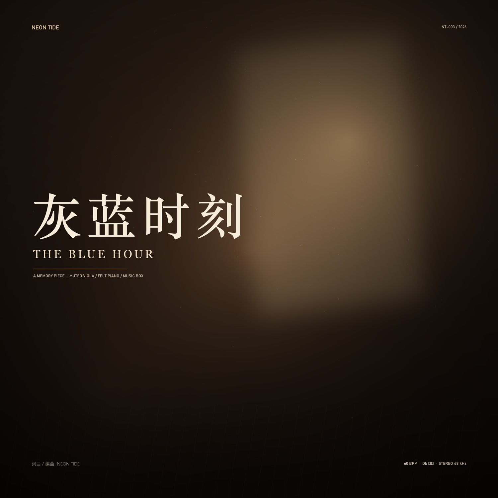

# compose_plugin · 固定流程作曲插件

把 [《音乐制作固定流程》](docs/音乐制作固定流程.md) 的十个阶段做成可执行代码：
**一张立项卡进去，一首带母带、MIDI、封面、创作手记与 QA 报告的作品出来。**

不是采样拼贴，也不是"文本生成音频"——所有声音由代码合成，所有决定都能在源码里找到出处。



## 它保证什么

- 母带 **−16 ~ −14 LUFS**、真峰 **≤ −1.0 dBFS**，两者同时成立（增益与限幅迭代收敛）；
- 分段动态由测量判定：高点只比前段高 **≤ 1.5 dB**，不靠音量堆高潮；
- 同一随机种子 → 同一份结果，可复现；
- 每首曲子附带 `qa_report.txt`：响度、真峰、分段 RMS、频段能量、立体声相关、逐项阈值判定。

**它不保证"好听"。** 测量只能证明没有削波、频谱与动态符合设计；没有做盲听，就不会在文档里写"听感已验证"。

## 示例工程

[`composer/demo/blue_hour/`](composer/demo/blue_hour/) — 《灰蓝时刻 / THE BLUE HOUR》，D♭ 大调、60 BPM、56 小节、3:54。

| 指标 | 实测 | 阈值 |
|---|---|---|
| 综合响度 | −15.2 LUFS | −16 ~ −14 |
| 真峰 | −2.6 dBFS | ≤ −1.0 |
| 立体声相关 | 0.919 | 0.85–0.95 |
| 频谱重心 | 315 Hz | 300–800 |
| B → Climax | +1.3 dB | ≤ +1.5 |

分段 RMS：Intro −26.9 / A1 −15.4 / B −13.6 / Climax −12.3 / A2 −15.7 / Coda −18.4 dBFS。
渲染耗时约 70 秒（纯 NumPy 滤波，未装 scipy）。

产物见 [`composer/demo/blue_hour/output/`](composer/demo/blue_hour/output/)：
封面、横幅、4 页创作手记 PDF、多轨 MIDI、QA 报告（母带 WAV 体积过大，未入库，可本地重新生成）。

## 安装

```powershell
git clone https://github.com/LuoTaiyu/compose_plugin.git
cd compose_plugin
python -m pip install -r requirements.txt
```

要求 Python 3.10+。依赖只有 **NumPy** 与 **Pillow**；**scipy 可选**——装了走 `scipy.signal.lfilter`，
不装则用 IIR→FIR + overlap-add 的等价实现，结果一致、只是慢一些。

## 使用

```powershell
# 校验一张立项卡
python -m composer.cli validate composer/demo/blue_hour/brief.json

# 渲染（产物落在 brief.json 同级的 output/）
python -m composer.cli build composer/demo/blue_hour/brief.json

# 生成一张空白立项卡
python -m composer.cli new my_song --title "我的曲子" --title-en "MY SONG"
```

退出码：`0` 全部阈值通过；`2` 渲染完成但有阈值未过（报告里写明是哪几项）。

换一首歌只需要换立项卡：改调性、小节数、段落四维、动机音级，其余全部重算。
字段说明与排错见 **[用户使用指南](USER_GUIDE.md)**。

## 仓库结构

```
composer/                 Python 包（唯一的实现）
  core.py                 立项卡、乐理、tempo map
  compose.py              和弦模板、五音动机、按四维曲线生成旋律
  instruments.py          毛毡钢琴 / 加弱音器中提琴 / 音乐盒 / 弦乐 / 簧风琴
  dsp.py                  二阶节滤波、零相位 EQ、FFT 卷积（scipy 可选）
  render.py               三级增益、混响发送、房间声
  master.py               EQ → tanh → 淡入淡出 → 响度/真峰收敛
  qa.py                   BS.1770 近似响度、4× 真峰、阈值判定
  export.py               WAV 24-bit、SMF、封面、4 页 PDF、README
  demo/blue_hour/         示例立项卡与产物
docs/                     流程文档与两份参考指南
USER_GUIDE.md             用户使用指南
COPYRIGHT.md              版权声明
```

## 文档

- [用户使用指南](USER_GUIDE.md) — 安装、立项卡字段、命令、产物、排错
- [音乐制作固定流程](docs/音乐制作固定流程.md) — 十阶段工序、参数基线、缺陷速查、验收清单
- [composer/README.md](composer/README.md) — 技术说明：模块与阶段的对应、设计取舍
- [音乐情感表达指南](docs/reference/音乐情感表达指南.md) / [自然感音色生成提示词](docs/reference/自然感音色生成提示词.md) — 方法论参考
- [版权声明](COPYRIGHT.md) — AGPL-3.0

## 许可

Copyright © 2026 LuoTaiyu. 以 **AGPL-3.0** 发布，详见 [COPYRIGHT.md](COPYRIGHT.md) 与 [LICENSE](LICENSE)。
